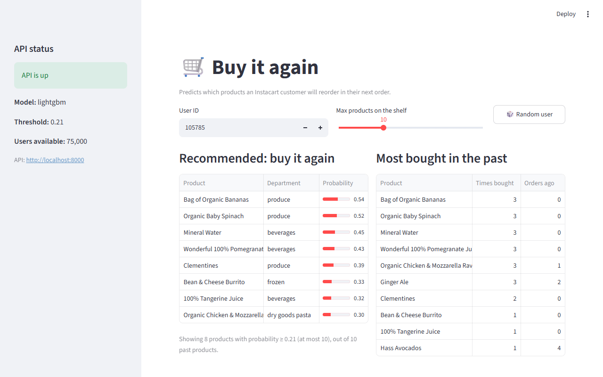
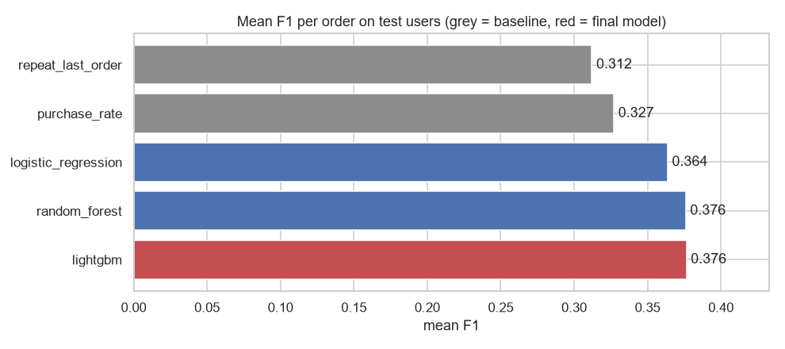
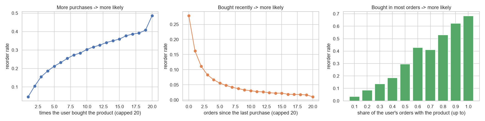

# Instacart "Buy It Again": Reorder Prediction, end to end

[](https://github.com/NamAnh-dev/Instacart-reorder-prediction-project/actions/workflows/ci.yml)

Predict which products a customer will **reorder** in their next Instacart order, and serve the
predictions through an **API** and a small **web app**.

```
raw CSV ──► preprocess ──► features ──► train & choose model ──► model.joblib ──► FastAPI ──► Streamlit
            (clean, split)  (16 features)  (3 models + 2 baselines)                 /predict     web app
```

**Stack:** Python, pandas, scikit-learn, LightGBM, FastAPI, Streamlit, Docker, pytest, GitHub Actions.



## Summary

| | |
|---|---|
| **Product question** | An online grocery app shows a "Buy it again" shelf. Which past products should be on it for a customer's next order? |
| **Data** | Kaggle Instacart: 3.4M orders, 206k users, 32M purchased items |
| **Model** | One row per (user, product) pair, binary label "reordered in the next order". LightGBM with 16 frequency/recency features. |
| **Result** | Mean F1 per order **0.376** vs **0.327** for the best simple rule (+15%). On a 10-item shelf, about **31%** of the products shown are bought again vs 27% with the rule. |
| **Serving** | FastAPI endpoint `/predict` + Streamlit app, both in Docker; 32 tests (pytest) and CI on GitHub Actions |

## 1. Problem

- **One row** = one (user, product) pair, for every product the user bought before (the candidates).
- **Label** = 1 if the user reordered that product in their next order.
- **Task** = binary classification; then we recommend the products whose probability is above a threshold.
- **Main metric** = mean **F1 per order**: like the Kaggle competition metric, but without its special "None" item
  (if a user reorders nothing and we recommend nothing, F1 = 1; if we recommend something, F1 = 0).
  We also report **precision@10 / recall@10** (a shelf of 10 items) and ROC AUC.

## 2. Data

[Kaggle – Instacart Market Basket Analysis](https://www.kaggle.com/c/instacart-market-basket-analysis).
Not included in this repository: see [Get the data](#get-the-data).

Every user has a purchase history (`prior` orders) and one last order:
- **131,209 users** have a `train` last order: we know what they bought → used for modeling,
  split **by user** into train / validation / test (70 / 15 / 15).
- **75,000 users** have a `test` last order (hidden by Kaggle) → we do not know their next order,
  so they are the users the **API** makes recommendations for.

## 3. Approach

| Step | What | Code |
|---|---|---|
| EDA | data quality, ordering habits, what is reordered, which signals predict a reorder | `notebooks/01_eda.ipynb` |
| Preprocessing | quality checks, timeline of days per user, labels, user split | `src/preprocess.py` |
| Features | 16 features: user, product and user × product (frequency, recency) | `src/features.py` |
| Baselines | repeat the last order; purchase-rate threshold | `src/baselines.py` |
| Models | Logistic Regression, Random Forest, LightGBM | `src/models.py` |
| Selection | threshold tuned on validation users, best validation F1 wins, tested once on test users | `src/train.py` |
| Error analysis | feature importance, F1 by user history, by department, examples | `notebooks/02_model_results.ipynb` |
| Serving | FastAPI + Streamlit, both in Docker | `api/`, `frontend/` |

**Design choices**
- **Split by user**, not by row: all products of a user are in the same group, so the model is never evaluated
  on a user whose next order it saw in training. (Product popularity features use everyone's *past* orders,
  which would also be known in production; no label is used there.)
- **Same feature code for training and serving**: features use only the purchase history, so the API sees
  exactly what the model saw in training.
- **No features about the next order** (day, hour, days since the last order): the shelf is built before
  we know when the customer will order.
- **Threshold, not 0.5**: only ~10% of the pairs are positive; the threshold that maximizes F1 on the
  validation users is much lower.

## 4. Results

Test users: 19,682 users never used for training or for any choice. Every setting (threshold) was chosen on the
validation users, and the final model is the one with the best **validation** F1.
The 95% interval comes from a bootstrap over the test users.

| System | Setting (chosen on valid) | Test F1 [95% CI] | Precision@10 | Recall@10 | ROC AUC | Avg items |
|---|---|---|---|---|---|---|
| Baseline: repeat last order | products of the last order | 0.312 [0.309, 0.316] | 0.230 | 0.455 | - | 10.3 |
| Baseline: purchase rate | order rate >= 0.26 | 0.327 [0.324, 0.331] | 0.272 | 0.518 | 0.772 | 10.7 |
| Logistic regression | probability >= 0.18 | 0.364 [0.360, 0.367] | 0.300 | 0.575 | 0.825 | 9.5 |
| Random forest | probability >= 0.20 | 0.376 [0.372, 0.380] | 0.306 | 0.584 | 0.832 | 8.8 |
| **LightGBM (final)** | probability >= 0.21 | **0.376** [0.373, 0.380] | 0.307 | 0.586 | 0.833 | 8.4 |



**Key findings** (details in `notebooks/02_model_results.ipynb`)
- The final model beats the best simple rule by **+0.049 F1 (+15%)** and recommends fewer products (8.4 vs 10.7).
- Random forest and LightGBM are tied (their intervals overlap). LightGBM was kept because its validation F1 is
  a bit higher; the choice is never made on test users.
- The most important features are **frequency and recency** of the user × product pair:
  `up_order_rate`, `up_rate_since_first`, `up_orders_since_last`, `up_n_orders`, `up_days_since_last`.
- F1 is stable across users with short and long histories: the model adapts the shelf size
  (about 6 products for users with 3-5 past orders, 12 for users with 41+).
- Weak spots: the 7% of users who reorder nothing (F1 about 0.19), and rarely bought products
  (pantry, household) whose timing is hard to predict.

**What the result means for the business**
- If the "Buy it again" shelf shows each customer's 10 most likely past products, about **3 in 10** of them are
  bought again in the next order (precision@10 0.307), vs **2.7 in 10** with the best simple rule (0.272).
  Customers with fewer than 10 past products see all of them.
- The shelf also catches more of what customers come back for: **59%** of the reordered products are in the
  top 10, vs **52%** with the rule (recall@10).
- When the shelf only shows the products above the threshold, it is **shorter** (8.4 products on average vs 10.7
  for the rule) and still more accurate (F1 0.376 vs 0.327): less screen space for a better guess.
- These are offline numbers on past orders. Whether the shelf leads to more items in the cart can only be
  measured with an A/B test.



## 5. Project structure

```
├── api/                FastAPI service (main.py, schemas.py, Dockerfile)
├── frontend/           Streamlit app that calls the API (app.py, Dockerfile)
├── src/
│   ├── config.py       paths, seed, feature list
│   ├── data.py         load the CSV files with small dtypes
│   ├── preprocess.py   step 1: clean, labels, user split
│   ├── features.py     step 2: feature engineering (training + serving)
│   ├── baselines.py    simple rules
│   ├── models.py       model definitions, feature importance
│   ├── evaluate.py     F1 per order, precision/recall@k, threshold search, bootstrap interval
│   ├── train.py        step 3: train, select, test, save
│   ├── pipeline.py     run steps 1-3
│   └── recommender.py  load model + features, make recommendations (used by the API)
├── notebooks/          01_eda.ipynb, 02_model_results.ipynb
├── reports/            model_comparison.md, metrics.json, feature_importance.csv, figures/
├── tests/              unit tests on a tiny hand-made dataset + API tests
├── .github/workflows/  CI: ruff + pytest
├── data/               raw/ (Kaggle CSV), processed/, serving/   (not in git)
├── models/             model.joblib, metadata.json               (not in git)
└── docker-compose.yml
```

## 6. How to run

### Setup (Python 3.12)

```bash
python -m venv .venv
.venv\Scripts\activate          # macOS/Linux: source .venv/bin/activate
pip install -r requirements.txt
```

### Get the data

The data comes from the Kaggle competition
[Instacart Market Basket Analysis](https://www.kaggle.com/c/instacart-market-basket-analysis).
You need a free Kaggle account and must accept the competition rules before downloading.
Put these 6 files in `data/raw/`:

```
data/raw/
├── aisles.csv
├── departments.csv
├── order_products__prior.csv   (the largest file: 32M rows, about 580 MB)
├── order_products__train.csv
├── orders.csv
└── products.csv
```

- **Browser:** download the zip from the competition's Data tab and unzip it into `data/raw/`
  (if the CSV files inside are zipped too, unzip them as well).
- **Kaggle CLI** (optional, needs an API token from your Kaggle settings saved as `~/.kaggle/kaggle.json`):

```bash
pip install kaggle
kaggle competitions download -c instacart-market-basket-analysis -p data/raw
```

Then unzip the downloaded file in `data/raw/` in the same way.

### Train

```bash
python -m src.pipeline
```

This runs the 3 steps: `src.preprocess`, `src.features`, `src.train` (each can also be run on its own).
For a quick trial on 10% of the users: `python -m src.train --sample 0.1`.

On a laptop with an Intel i5-1035G1 (4 cores) and 16 GB of RAM, the full pipeline took about **8 minutes**
(preprocess 1 min, features 1 min, training 6 min) and used about **6 GB of RAM** at its peak.

### Serve with Docker

```bash
docker compose up --build
```

- API docs (Swagger): http://localhost:8000/docs
- Web app: http://localhost:8501

The containers read the trained model from `models/` and the serving features from `data/serving/`
(mounted as volumes), so train first.

### Serve without Docker

Run each command in its own terminal:

```bash
uvicorn api.main:app --port 8000
```

```bash
streamlit run frontend/app.py
```

### API

| Method | Endpoint | Description |
|---|---|---|
| GET | `/health` | status, model name, threshold, number of users |
| POST | `/predict` | body `{"user_id": 3, "k": 10}` → recommended products with probabilities |
| GET | `/users/{user_id}/history` | the user's most bought products |
| GET | `/users/sample?n=5` | random user ids to try |

```bash
curl -X POST http://localhost:8000/predict -H "Content-Type: application/json" -d '{"user_id": 3, "k": 5}'
```

### Tests and lint

```bash
pytest -q
ruff check .
```

The same checks run on GitHub Actions for every push (`.github/workflows/ci.yml`).

## 7. Limitations and next steps

- **Offline metric only.** F1 on past data is not business impact; an A/B test would measure it (e.g. clicks
  on the shelf, items added to cart).
- **Reorders only.** Products the user never bought are never recommended.
- **One threshold for everyone.** The weakest group is users who reorder nothing. A next step is to choose the
  shelf size per user (and allow an empty shelf more often), as the top Kaggle solutions did.
- **No real dates.** The data has no timestamps, so the split is by user, not by time.
- **Batch features.** Serving features are computed in advance; in production they would be refreshed after
  every new order.
